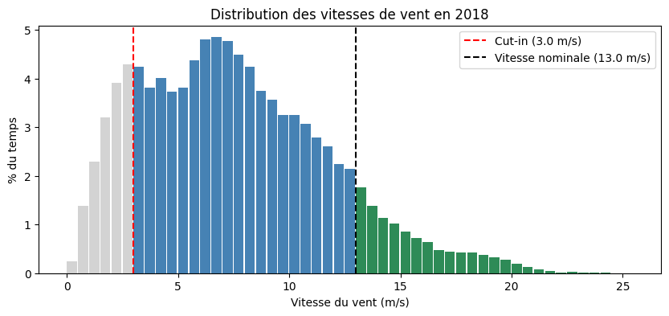
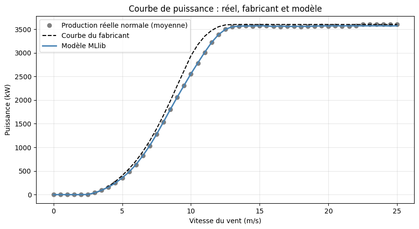

# Wind Turbine Performance Monitoring

**Détection des sous-performances d'une éolienne et estimation des pertes d'énergie avec PySpark sur Databricks.**

À partir d'un an de données SCADA (une mesure toutes les 10 minutes), ce projet détecte les périodes où une éolienne produit moins que prévu, estime l'énergie perdue et identifie les épisodes les plus coûteux. Une courbe de puissance apprise avec MLlib vérifie ensuite si la courbe du fabricant est une bonne référence.


## Résultats clés

| Indicateur | Valeur |
| --- | --- |
| Couverture des données | 96,1 % de l'année 2018 |
| Production réelle / attendue (courbe du fabricant) | 11 013 / 12 567 MWh (87,6 %) |
| Pertes dues aux anomalies d'au moins 1 h | **647 MWh** (courbe du fabricant), **593 MWh** (modèle) |
| Part des arrêts complets dans les pertes | 66 % |
| Part de l'hiver (décembre à février) dans les pertes | 86 à 87 % |
| Épisode le plus coûteux | 22 – 26 janvier : 79 h, 170 MWh, soit 26 % des pertes de l'année |
| Erreur du modèle de comportement normal (MAE) | 78 kW, contre 117 kW pour la courbe du fabricant |

**À retenir** : l'éolienne perd environ 600 MWh par an à cause d'anomalies durables, dont les deux tiers par des arrêts complets et presque toutes en hiver. Une poignée d'épisodes concentre l'essentiel des pertes : c'est là qu'un exploitant devrait diagnostiquer en priorité.

## Données

[Wind Turbine Scada Dataset](https://www.kaggle.com/datasets/berkerisen/wind-turbine-scada-dataset) (Kaggle) : une éolienne en Turquie, année 2018, 50 530 mesures.

| Colonne | Description |
| --- | --- |
| `Date/Time` | date et heure de la mesure (pas de 10 minutes) |
| `LV ActivePower (kW)` | puissance produite |
| `Wind Speed (m/s)` | vitesse du vent à hauteur de nacelle |
| `Theoretical_Power_Curve (KWh)` | puissance attendue d'après la courbe du fabricant |
| `Wind Direction (°)` | direction du vent |

Caractéristiques déduites des données : démarrage (cut-in) à **3,0 m/s**, vitesse nominale de **13,0 m/s**, puissance nominale de **3 600 kW**.

## Méthode

Le pipeline suit l'architecture médaillon de Databricks, avec une table Delta à chaque étape.

| Couche | Table | Contenu |
| --- | --- | --- |
| Bronze | `bronze_scada` | CSV brut, sans modification |
| Silver | `silver_scada` | données nettoyées et annotées |
| Gold | `gold_pertes_mensuelles`, `gold_episodes_anomalies` | pertes par mois et par épisode |

1. **Nettoyage (silver)** : conversion des dates, puissances négatives ramenées à 0 (consommation propre de l'éolienne à l'arrêt), repérage des 32 interruptions de données.
2. **Drapeaux d'anomalie** : *arrêt* (puissance nulle alors que la puissance attendue est positive) et *sous-performance* (moins de 70 % de la puissance attendue). Les lignes sont signalées, jamais supprimées.
3. **Épisodes (gold)** : les anomalies consécutives forment un épisode, coupé par les interruptions de données. Seuls les épisodes d'au moins 1 heure sont retenus.
4. **Pertes** : pour chaque mesure en anomalie, (puissance attendue − puissance réelle) × 10 min, agrégée par mois, par cause et par épisode.
5. **Modèle de comportement normal (MLlib)** : une forêt aléatoire apprend la production de l'éolienne en fonctionnement normal à partir du vent et de sa direction, puis sert de référence alternative à la courbe du fabricant.

## Visualisations

**Distribution des vitesses de vent.** Le vent est sous le seuil de démarrage 15,3 % du temps (en gris) et au-dessus de la vitesse nominale 10,8 % du temps (en vert). Le vent moyen est de 7,6 m/s.



**Courbe de puissance : réel, fabricant et modèle.** Même en fonctionnement normal, l'éolienne produit moins que la courbe du fabricant entre 7 et 12,5 m/s. Le modèle MLlib suit fidèlement la production réelle.



## Modèle de comportement normal

Le modèle est entraîné uniquement sur les mesures normales de janvier à septembre, puis testé sur octobre à décembre.

| Référence (test, octobre à décembre) | MAE | RMSE | R² |
| --- | --- | --- | --- |
| Modèle, vent + direction | **77,6 kW** | **119,5 kW** | 0,991 |
| Modèle, vent seul | 82,0 kW | 128,3 kW | 0,990 |
| Courbe du fabricant | 117,5 kW | 183,6 kW | 0,980 |

- Le modèle réduit l'erreur d'environ un tiers par rapport à la courbe du fabricant.
- L'écart entre entraînement (56 kW) et test (78 kW) reste modéré : pas de surapprentissage marqué.
- Avec ce modèle comme référence, les pertes passent de 647 à **593 MWh (−8 %)** : environ 54 MWh de « pertes » correspondaient au comportement normal du site. La concentration des pertes en hiver est confirmée.

## Limites et pistes d'amélioration

**Limites**

- Le seuil de 70 % et la durée minimale d'1 heure sont des choix raisonnables mais arbitraires.
- Sans alarmes ni température, les causes des anomalies (panne, givre, maintenance, bridage) ne peuvent pas être confirmées.
- Le modèle n'utilise que le vent et sa direction ; la densité de l'air, qui varie d'environ 10 % entre l'hiver et l'été, n'est pas prise en compte.
- Une seule éolienne, sur une seule année.

**Pistes d'amélioration**

- Ajouter des données météo (température, pression) pour tenir compte de la densité de l'air et tester l'hypothèse d'un givrage des pales en hiver.
- Améliorer la validation du modèle avec une séparation par semaines alternées ou une validation croisée par mois, pour tester toutes les saisons.
- Croiser avec les alarmes de l'éolienne pour confirmer la cause de chaque épisode.
- Appliquer le pipeline à plusieurs éoliennes, par exemple les 4 turbines du parc ENGIE de La Haute Borne, avec `Window.partitionBy("turbine_id")`.

## Reproduire le projet

1. Créer un compte gratuit [Databricks Free Edition](https://www.databricks.com/learn/free-edition).
2. Télécharger `T1.csv` depuis [Kaggle](https://www.kaggle.com/datasets/berkerisen/wind-turbine-scada-dataset).
3. Dans Databricks, créer un volume (*Catalog* → `workspace` → `default` → *Create volume*), par exemple `donnees`, et y importer le fichier.
4. Cloner ce dépôt dans un *Git folder* Databricks et ouvrir le notebook.
5. Adapter le chemin du CSV dans la cellule de création de la table bronze, puis lancer **Run all**.

## Structure du dépôt

```
├── wind-turbine-performance.ipynb   # notebook complet : bronze, silver, gold, MLlib
├── images/
│   ├── distribution_vent.png
│   └── courbe_puissance_modele.png
└── README.md
```

## Outils

PySpark (DataFrames, fonctions de fenêtre, Spark SQL), Databricks (notebooks, tables Delta, Git folders), MLlib (Pipeline, RandomForestRegressor), matplotlib.
